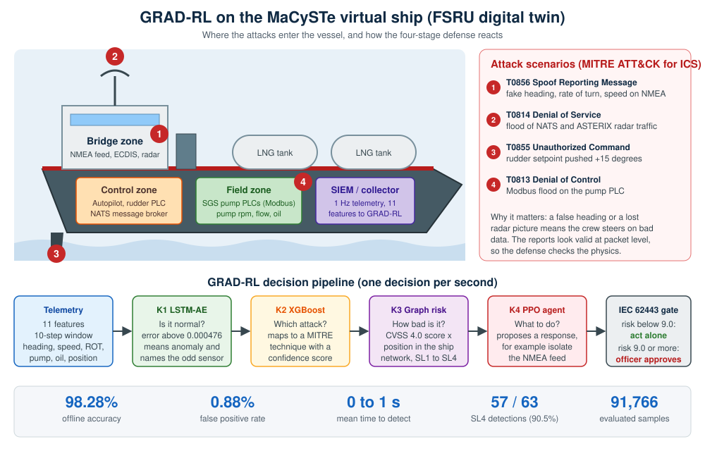

# GRAD-RL on the MaCySTe Maritime Digital Twin

Validation of the GRAD-RL autonomous cyber-physical defense framework on [MaCySTe](https://crack-mcr.github.io/MaCySTe/), a containerized virtual FSRU (floating LNG unit) built for maritime cybersecurity research.

GRAD-RL watches the ship's sensor data, recognizes which MITRE ATT&CK for ICS technique is under way, scores its risk, and proposes a response. Responses at the highest risk level are held for a human officer (IEC 62443 safety gate).



## Pipeline

| Stage | Role | Implementation |
|-------|------|----------------|
| K1 LSTM autoencoder | Flags anomalies from a 10-step window of 11 features and names the most suspicious sensor | Keras |
| K2 XGBoost | Maps each observation to a MITRE ATT&CK for ICS technique, with a confidence score | XGBoost |
| K3 Graph risk | Combines a CVSS 4.0 base score with the position of the asset in the ship network, giving a risk score and an IEC 62443 level (SL1 to SL4) | Python |
| K4 PPO agent | Proposes a response, for example isolating the NMEA feed | PPO |
| Safety gate | Risk below 9.0: the response runs on its own. Risk of 9.0 or more: an operator must approve | IEC 62443 |

Input features: `rate_of_turn`, `speed_knots`, `lat`, `lon`, `pump_rpm`, `flow_rate`, `oil_temp`, `oil_pressure`, `heading_sin`, `heading_cos`, `rate_of_turn_rstd`.

## Key results (offline evaluation, 91,766 samples)

| Metric | Value |
|--------|-------|
| Accuracy | 98.28% |
| False positive rate | 0.88% |
| T0856 F1 | 0.6424 |
| T0814 F1 | 0.6607 |
| Mean time to detect, T0856 | 1 s |
| Mean time to detect, T0814 | 0 s |
| LSTM-AE validation loss | 0.000277 |
| SL4 detections | 57 / 63 (90.5%) |

The full model settings are in [`models/model_card_macyste.json`](models/model_card_macyste.json).

## Repository layout

```
.
├── api/            FastAPI inference service (K1 to K4 plus explanations)
├── collector/      Telemetry collector (NMEA and Modbus from OpenSearch, labeled CSV)
├── bridge/         Live bridge: sends new telemetry rows to the API and logs decisions
├── training/       Retraining script for the LSTM-AE and XGBoost models
├── evaluation/     Full pipeline replay on a labeled dataset
├── attacks/        Attack scripts used to generate and test attack data
├── models/         Model card (thresholds, features, offline metrics)
├── results/        Live attack decision log (JSONL) and a combined attack run (CSV)
├── docs/           Technical architecture PDF and figures
└── requirements.txt
```

## Attack scenarios

| MITRE technique | What happens on the ship | Scripts |
|-----------------|--------------------------|---------|
| T0856 Spoof Reporting Message | False heading, rate of turn or speed is injected into the NMEA feed | `attacks/attack_t0856_heading090.py`, `attack_t0856_heading180_live.py`, `attack_t0856_rot_spoof.py`, `attack_t0856_speed_spoof.py` |
| T0814 Denial of Service | Flood of NATS broker traffic | `attacks/attack_t0814_nats_flood.py` |
| T0855 Unauthorized Command | Rudder setpoint written to the master PLC (+15 degrees) | `attacks/attack_t0855_rudder.py`, `attack_t0855_host.py` |
| T0813 Denial of Control | Modbus flood on the pump PLC | `attacks/attack_t0813_modbus_dos.py`, `attack_t0813_host.py` |

## Quick start

```bash
pip install -r requirements.txt

# 1. Start the inference API (needs the trained model files, see api/api_detective_macyste.py)
uvicorn api.api_detective_macyste:app --port 8000

# 2. Collect labeled telemetry from a running MaCySTe testbed
python collector/macyste_collector.py --label normal --duration 300 --output data.csv

# 3. Run an attack and record it
python attacks/attack_t0856_heading090.py

# 4. Replay a dataset through the full pipeline
python evaluation/full_replay_v2.py

# 5. Retrain the models
python training/retrain_macyste.py --dataset data.csv
```

Notes:
- The collector and attack scripts expect a running MaCySTe testbed. IP addresses, container names and the `/root/MaCySTe` output paths are set at the top of each script, so adjust them for your setup.
- The trained model files are not stored in this repository. The API loads them from `models/`, so place them there or retrain with `training/retrain_macyste.py` on the dataset below.

## Dataset

Live telemetry and attack scenarios from the digital twin: [10.5281/zenodo.21130212](https://doi.org/10.5281/zenodo.21130212) (CC BY 4.0).

## Related work

- Main GRAD-RL repository (SWaT, WADI and GRFICSv3): [GRAD-RL-Autonomous-Cyber-Physical-Defense-for-ICS](https://github.com/veyselalevcan/GRAD-RL-Autonomous-Cyber-Physical-Defense-for-ICS)
- GRFICSv3 dataset: [10.5281/zenodo.20433521](https://doi.org/10.5281/zenodo.20433521)
- Architecture details: [`docs/GRAD-RL_Technical_Architecture_.pdf`](docs/GRAD-RL_Technical_Architecture_.pdf)

## Citation

V. Alevcan, N. Mateus Coelho and L. M. Campos, "When Ship Sensors Lie: Testing Autonomous Cyber Defence on a Virtual Vessel," 10th NATO NMIOTC Cyber Security Conference in the Maritime Domain, Greece, September 2026.

Veysel Alevcan, COPELABS, Lusófona University and PDMFC SA.
